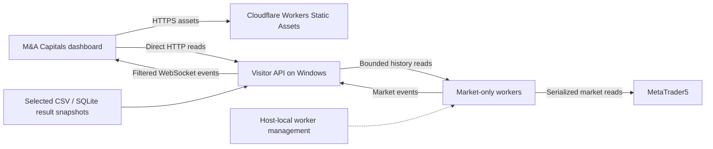
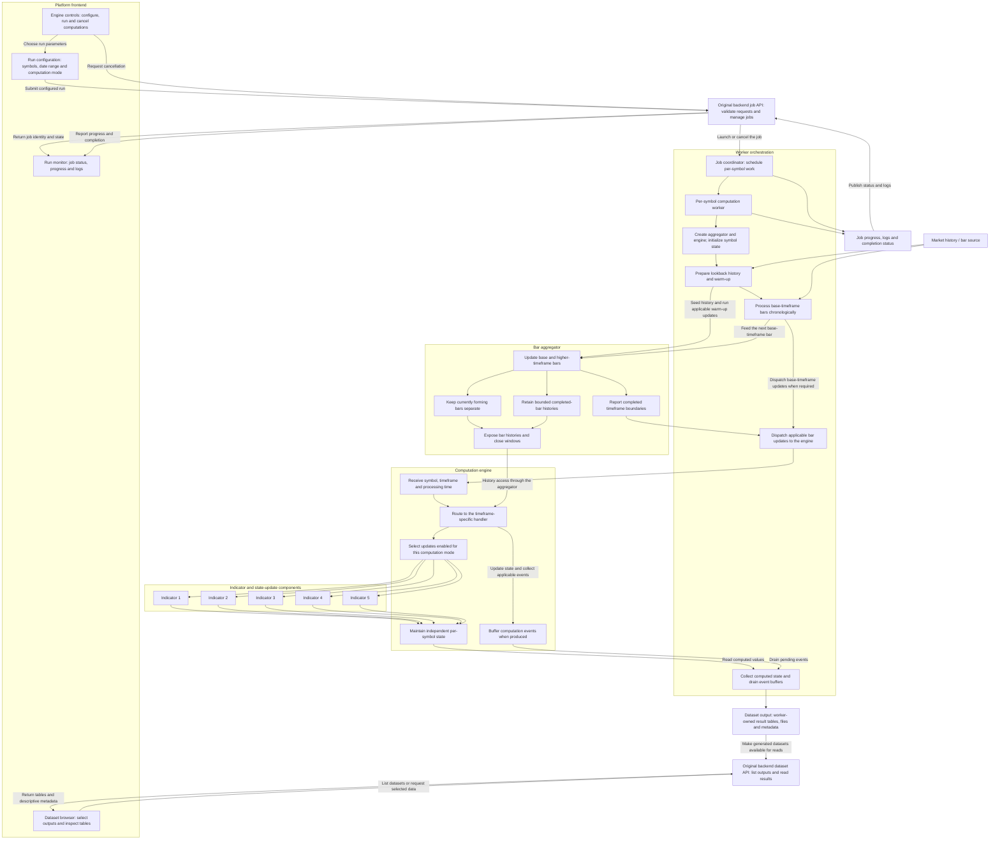

# M&A Capitals

M&A Capitals is a trading analysis platform built around a trading engine for
backtesting and live operation. The engine processes historical or live bars
across symbols and timeframes, updates indicators and computation state, and
produces datasets for analysis.

Charts, data visualisation and research tools bring that work into one workspace.
Configure a run, follow its progress and logs, then explore the results alongside
the market data behind them. You can jump from a result row to the matching point
on a chart without losing your place.

The trading engine is excluded from this version to comply with a non-disclosure agreement.

## Tech stack

| Layer                 | Technology                            |
| --------------------- | ------------------------------------- |
| Interface and routing | React, TypeScript, React Router       |
| Workspace panels      | react-resizable-panels                |
| Charts                | Lightweight Charts                    |
| Tables and JSON views | TanStack Virtual, UIW React JSON View |
| Build and checks      | Vite, TypeScript, Node.js test runner |
| API runtime           | Python, FastAPI, Pydantic, Uvicorn    |
| Market connection     | MetaTrader5 on Windows                |
| Data processing       | pandas, PyArrow, HTTPX                |
| Live delivery         | WebSocket                             |
| Backend verification  | Python unittest, synthetic fixtures   |
| Frontend hosting      | Cloudflare Workers Static Assets      |

## Features

### Arrange your workspace

- Open several workspace tabs, each with its own layout and chart settings.
- Split a workspace into up to eight slots. Drag panel headers to move them and
  use the dividers to resize them.
- Mix charts, datasets and logs, or change what a slot shows without rebuilding
  the layout.
- Compare symbols and timeframes side by side. Link charts to change their symbol
  together while keeping a separate timeframe for each one.
- Workspace tabs, chart preferences and theme are saved in your browser.
  On mobile, the workspace uses one slot at a time.

### Work with charts

- Browse candlestick history and live quotes. Each chart has its own symbol,
  source and timeframe, with scrolling, zooming and history navigation.
- Measure price ranges and draw Fibonacci tools. Adjust or clear drawings
  directly on the chart.
- Use a measured range's starting point to navigate another chart, choosing the
  destination timeframe while carrying over the source symbol.
- Change chart colours and grid settings, then reuse chart templates rather than
  setting up every panel from scratch.

### Jump from a table to a chart

When a dataset is available from the backend, you can keep its table open beside
your charts:

1. Browse a result table and select a timestamp through its date-navigation tool.
2. Choose an open chart as the destination, rather than replacing the dataset view.
3. The chart jumps to that date and briefly highlights it, using the row's symbol
   if one is provided. The table stays open so you can keep comparing results.

Chart history is still limited to the sources and read limits set by the backend.

### Explore datasets

- Browse the result folders made available by the backend and open tables or JSON
  in a workspace panel.
- Explore wide tables with virtualized rows and columns, global search,
  expression and per-column filters, sorting and local row marking.
- Copy loaded data and switch between table and JSON views. For paged results,
  search, sorting, JSON and copying apply to loaded rows, not unseen pages.
## Market data and result delivery

The dashboard gets market history and result snapshots through a Python API.
Market-only workers handle MT5 reads, while WebSocket events keep charts updated.
The repository's data-serving architecture is shown below; the full computation
workflow follows in the next section.

The visitor API and internal worker callbacks share one backend runtime and
registry.

### Backend responsibilities

- Serve only the symbols, source aliases and result tables selected on the host.
- Limit history and result reads, and filter live events by source and symbol.
- Serve immutable, indexed result snapshots, with support for masked templates.
- Block visitor writes and access to private routes on the server, not just in
  the interface.
- Leave out computed period-level overlays: `/levels/{symbol}` is not a visitor
  route. Supported stored results, including the legacy levels schema, can still
  be read. Reading those results does not calculate an indicator.

## Trading engine

The platform separates job scheduling, per-symbol execution, bar aggregation and
indicator updates. This keeps the engine focused on computation while workers
handle history, execution and output. The design below describes the full
pipeline without exposing strategy formulas, thresholds or execution rules.

### Engine tech stack

| Layer                            | Technology                                                      |
| -------------------------------- | --------------------------------------------------------------- |
| Engine runtime                   | Python, custom event-driven computation                         |
| Numerical and tabular processing | NumPy, pandas                                                   |
| Bar aggregation and history      | Custom Python aggregator, bounded `collections.deque` histories |
| Parallel computation             | `multiprocessing`, `concurrent.futures.ProcessPoolExecutor`     |

### Trading engine design

- **The frontend submits jobs through the API.** It sends run parameters or a
  cancellation request to the backend job API, then uses the job ID to follow
  progress, logs and completion. It does not create engine instances in the browser.
- **Workers run the jobs.** A coordinator schedules work by symbol. Each worker
  prepares its history, creates an engine and aggregator, runs the processing
  loop and collects results. The engine itself neither manages the worker pool
  nor writes result files.
- **The aggregator builds the bars.** It builds the selected timeframes from the
  worker's base stream, keeps forming bars separate from completed history and
  reports when timeframes close. The base timeframe and lookback depend on the
  computation; workers do not all replay M1 bars.
- **The engine updates computation state.** Workers call `on_bar` with a symbol,
  timeframe and processing time. The engine passes the update to the matching
  timeframe handler, reads history from the aggregator and updates the components
  enabled for that mode. It keeps state separately for each symbol. Not every
  indicator runs on every bar, and forming bars are treated differently from
  completed bars.
- **Workers collect state and events into results.** They read the engine's
  per-symbol state and drain the relevant event buffers to build output tables.
  Worker orchestration also handles progress, logs and final job status.
- **Reading results is separate from running jobs.** Workers save result tables
  and metadata. The dataset API lets the frontend list and read selected outputs;
  opening a dataset does not run the engine again.

## Integration and repository scope

The [M&A Capitals design system](src/design-system/README.md) defines shared visual
tokens, dark/light themes and reusable presentation components. Market data access
and workspace behaviour are handled separately.

The frontend handles navigation, chart workspaces and presentation. The backend
connects to MT5 and serves data. Workers are managed locally on the Windows host;
the dashboard cannot start or stop them, execute trades or run strategies.
Market-only workers expose no order, positions or account-history routes.

The frontend is hosted on Cloudflare Workers Static Assets. Its browser connects
directly to the existing visitor API; the Windows/MT5 backend is not deployed by
the frontend delivery pipeline. Analytics is disabled: no page-view collector,
automatic SPA tracking or workspace/dataset telemetry is included.

Allowed browser origins, data sources and results are configured on the host.
If a source is missing or has not been selected, the backend does not substitute
another worker or a synthetic feed.

The product description and engine design above cover the full platform.
This repository shares its dashboard and market-data backend, not the private
computation engine, computation workers, operator controls or original research
outputs. Engine Run buttons and selected indicator controls are disabled, and
private names are masked. The log viewer uses 10 fixed, searchable synthetic job
snapshots; selected dataset templates use synthetic dates and `xxxx` placeholders.
Neither represents live computation or private research values.

MT5 credentials and the original application's Git history are not included.
Installing the source does not provide datasets, start a live service or connect
to a broker. Synthetic test fixtures are separate from both live market data and
the showcase templates.

Frontend source is at the repository root. Backend source, runtime dependencies,
scripts and tests are under `backend/`.

## License and notices

Incorporated release tooling is adapted from `benhammoush/ci-cd-workflows`.

Original first-party source is available for portfolio inspection under the
[frontend source terms](LICENSE.md) and [backend source terms](backend/LICENSE.md),
not a general open-source reuse licence. Third-party software retains its own
licences in the [frontend notices](assets/third-party-notices.txt) and
[backend notices](backend/THIRD_PARTY_NOTICES.txt). The notice collections retain
their separate scopes and do not restrict third-party rights.
